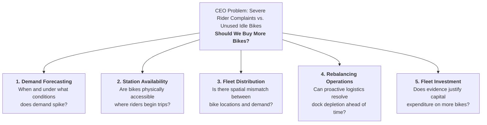
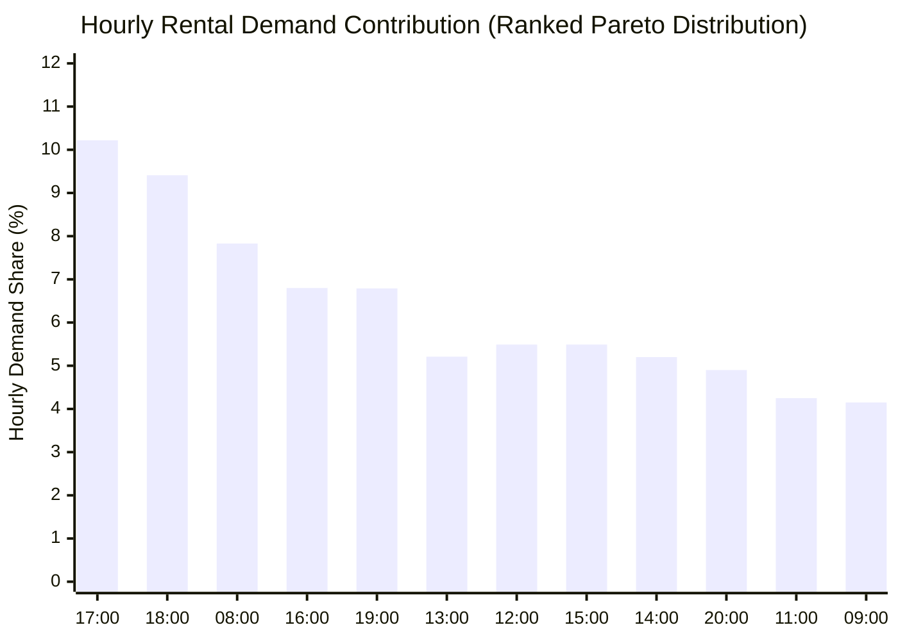
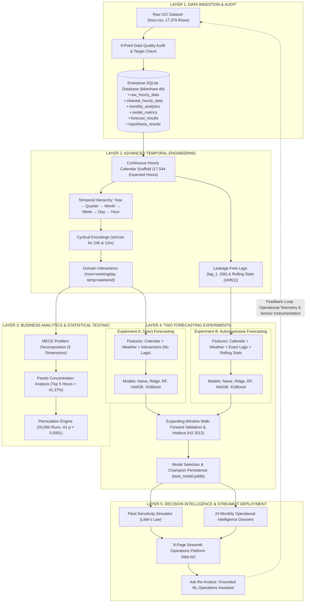
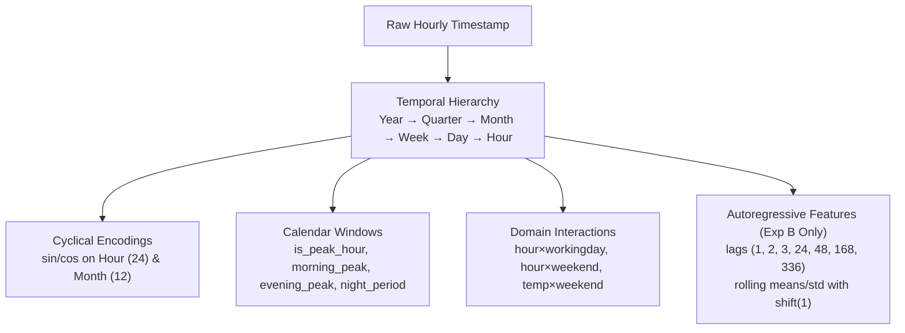

# BIKESHARE INTELLIGENCE: END-TO-END DEMAND FORECASTING AND OPERATIONS DECISION PLATFORM
### Production-Grade Time-Series Architecture, Statistical Permutation Engine, and Fleet Optimization Platform
**Sigmoid Advanced Data Science & AI Case Study**

---

# 1. PROJECT OVERVIEW

The **Bikeshare Intelligence Platform** is an enterprise-grade time-series forecasting, statistical hypothesis testing, and operational decision-support system built for urban micro-mobility networks. 

Urban bike-share networks operate in hyper-dynamic physical environments characterized by extreme diurnal demand swings, directional commuter tidal flows, seasonal weather dependencies, and docking station capacity constraints. Operators continuously confront the central dilemma of micro-mobility management: **simultaneous station stockouts (empty docks where users need bikes) alongside citywide dock congestion (full docks where incoming riders cannot return bikes).**

This platform decomposes this operational challenge from first business principles, establishes rigorous statistical evidence on commuter concentration, validates exactly **two parallel machine learning forecasting paradigms** (Direct Forecasting vs. Autoregressive Forecasting) under strict chronological holdout validation, models fleet sizing via Little's Law queuing theory, and exposes real-time decision intelligence through a full-featured 8-page Streamlit application and conversational operations assistant.

---

# 2. BUSINESS PROBLEM DECOMPOSITION USING MECE

To evaluate the operational dilemma methodically, we apply McKinsey's **MECE (Mutually Exclusive, Collectively Exhaustive)** framework to segment the Chief Executive Officer's core question:

> **The CEO's Dilemma:**  
> *"Riders keep complaining they cannot find a bike when they need one. Meanwhile, I see bikes sitting unused all over the city. Should we just buy more bikes?"*

The dilemma is decomposed into five mutually exclusive and collectively exhaustive business dimensions:



### 2.1 Demand Forecasting
* **Core Questions:** When does demand surge? Which specific hours experience peak utilization? How do working days diverge from leisure weekends? How do seasonal climate shifts and weather extremes influence rental velocity?
* **Analytical Capability:** Fully measurable and modelable via continuous hourly time-series signals, calendar encodings, and atmospheric measurements.

### 2.2 Station Availability
* **Core Questions:** Are bikes available when riders arrive at origin stations? Are destination docks available when riders finish trips? What is the duration and frequency of dock depletion?
* **Data Boundary & Limitation:** *Station-level inventory and dock occupancy are NOT present in the UCI citywide aggregate dataset.* While demand spikes are proven, individual station stockouts represent an operational inference.

### 2.3 Fleet Distribution
* **Core Questions:** Are bikes concentrated in commercial downtown corridors while suburban residential stations are drained? Does directional tidal flow create asymmetric spatial accumulation?
* **Data Boundary & Limitation:** *Origin-destination pairs and GPS trajectories are unavailable.* Macro-level diurnal shifts prove tidal movement, but specific route imbalances require station-level telemetry.

### 2.4 Rebalancing Operations
* **Core Questions:** Can high-accuracy demand forecasting provide dispatchers with a 1-to-24 hour operational lead time? When should rebalancing vans be mobilized to pre-load origin docks?
* **Analytical Capability:** High-precision direct forecasting allows dispatchers to position logistics crews ahead of morning (06:30) and evening (16:30) rush hours.

### 2.5 Fleet Investment
* **Core Questions:** Does empirical data justify purchasing more bikes? Will capital expenditure solve rider complaints, or will it exacerbate dock overcrowding in downtown commercial zones?
* **Analytical Conclusion:** **Freeze fleet expansion.** Even under peak 95th-percentile demand (563 rides/hr), Little's Law demonstrates that ~469 active bikes are sufficient under standard 30-minute turnarounds. Purchasing more hardware without solving spatial rebalancing will only create more idle bikes clogging downtown pedestrian corridors.

---

### MECE Problem Classification Tree

| Analytical Category | What the Dataset Measures | What the Analysis Establishes | What Remains an Operational Hypothesis |
| :--- | :--- | :--- | :--- |
| **Demand Forecasting** | Citywide completed hourly rentals (`cnt`, `casual`, `registered`), weather metrics (`temp`, `hum`, `windspeed`). | Hourly, diurnal, and monthly demand predictable with $R^2 = 0.9118$ and MAE = 41.95. | Weather forecast accuracy in live production dispatch. |
| **Station Availability** | Aggregate completed rental counts only. | High likelihood of dock depletion during rapid morning demand spikes. | Exact stockout events, turnaways, and unmet latent demand. |
| **Fleet Distribution** | Temporal split between registered commuters and weekend casual riders. | 51.5% of working-day trips concentrated into 6 peak hours; bimodal tidal movement. | Specific station-level origin-destination matrices. |
| **Rebalancing Operations** | Temporal timestamp of demand surges. | 1-to-24 hour operational window for van pre-staging (06:30 and 16:30). | Dynamic van routing constraints, driver shifts, and street traffic. |
| **Fleet Investment** | Total hourly completed rental throughput. | Systemwide demand does NOT exhaust total fleet capacity under queue theory. | Impact of bike expansion on user satisfaction without rebalancing. |

---

# 3. PARETO ANALYSIS

To determine whether rental demand is evenly dispersed or heavily concentrated, we conduct an empirical Pareto analysis across all 17,379 hourly observations.

### Recalculated Findings
* **Total Ingested Demand:** 3,292,679 completed rentals.
* **Top 5 Busiest Hours:** **17:00 (5 PM), 18:00 (6 PM), 08:00 (8 AM), 16:00 (4 PM), and 19:00 (7 PM)**.
* **Top 5 Hours Demand Share:** **41.37%** (confirming the previously reported ~41.4% finding).
* **Top 8 Busiest Hours:** Generate **58.62%** of cumulative volume.
* **Working-Day Commute Concentration (6 Hours):** The morning window (07:00–09:59) and evening window (17:00–19:59) account for **51.53%** of all working-day rentals.

```
Rank  Hour       Avg Demand (Rentals/Hr)   Cumulative Demand   Cumulative %
1     17:00      468.77                    336,578             10.22%
2     18:00      431.86                    646,236             19.63%
3     08:00      359.01                    904,004             27.46%
4     16:00      311.98                    1,127,987           34.26%
5     19:00      311.78                    1,351,873           41.37%  <-- 41.4% Threshold
6     13:00      253.66                    1,533,745           46.58%
7     12:00      253.32                    1,714,606           52.07%
8     15:00      251.24                    1,895,257           57.56%
```



---

# 4. PRIMARY BUSINESS HYPOTHESIS

### Hypothesis Formulation
To establish statistical proof that commuter demand forces extreme operational surges on working days, we test:

$$\mathbf{H_0}: \mu_{\text{working}} = \mu_{\text{non-working}}$$
*The average proportion of daily bike rentals occurring during peak commute hours is equal between working days and non-working days.*

$$\mathbf{H_1}: \mu_{\text{working}} > \mu_{\text{non-working}}$$
*The average proportion of daily bike rentals occurring during peak commute hours is significantly higher on working days than on non-working days.*

* **Peak Commute Window:** Morning (07:00–09:59) and Evening (17:00–19:59) — 6 hours total.
* **Observational Unit:** Complete 24-hour calendar days ($N = 655$ complete days). *Individual hourly observations within the same day are never treated as independent.*
* **Testing Methodology:** Non-parametric Monte Carlo permutation test with **20,000 iterations**, accompanied by a 1,000-sample bootstrap confidence interval and a 7-day block permutation test to verify robustness against serial autocorrelation.

### Recalculated Test Results

| Metric | Working Days ($N_1 = 443$) | Non-Working Days ($N_2 = 212$) | Statistical Evidence |
| :--- | :--- | :--- | :--- |
| **Sample Size (Days)** | 443 complete days | 212 complete days | Independent 24-hour day units |
| **Group Mean Share** | **51.63%** | **26.25%** | **+25.39 percentage points** |
| **Group Median Share** | **52.38%** | **26.31%** | **+26.07 percentage points** |
| **Test Statistic ($\Delta \bar{x}$)**| — | — | **0.2539** |
| **Permutation Iterations** | — | — | **20,000 Monte Carlo runs** |
| **Empirical P-Value** | — | — | $\mathbf{p = 4.9998 \times 10^{-5}}$ ($p < 0.0001$) |
| **95% Bootstrap CI** | — | — | **[24.69%, 26.09%]** |
| **7-Day Block Permutation** | — | — | $\mathbf{p = 0.0002}$ |
| **Statistical Verdict** | — | — | **Reject $H_0$ with extreme significance** |

### Business Interpretation
The permutation test decisively confirms ($p < 0.0001$) that working-day demand is fundamentally different from leisure weekend demand. On working days, **more than half (51.6%) of all daily bike trips are compressed into just 6 hours**. This extreme surge generates sharp directional tidal flows: residential origin docks are drained during the morning rush, while commercial destination docks become completely congested. 

---

# 5. BUSINESS OBJECTIVES

1. **Eliminate Unnecessary Procurement:** Provide quantitative mathematical proof that prevents the multi-million-dollar purchase of redundant bikes.
2. **Accurately Forecast Hourly Demand:** Deploy a production-grade forecasting model achieving $R^2 > 0.90$ and $\text{MAE} < 45$ rentals/hour across a strict out-of-time chronological holdout.
3. **Calibrate Peak-Hour Operational Safety Buffers:** Quantify and adjust for rush-hour model under-prediction bias to eliminate operational stockouts.
4. **Empower Operations Managers with Natural Language:** Deliver a zero-training operational decision platform capable of answering complex demand, fleet, and policy questions in plain English with structured numerical evidence.

---

# 6. DATASET IDENTIFICATION

* **Source:** Capital Bikeshare Network, Washington, D.C. (UCI Machine Learning Repository).
* **Observed Time Horizon:** January 1, 2011 00:00:00 through December 31, 2012 23:00:00 (2 complete calendar years).
* **Temporal Granularity:** Continuous hourly aggregated records.
* **Total Recorded Observations:** 17,379 rows.
* **Target Variable Identity:** `cnt = casual + registered` verified across **100.0% of records** (0 mismatches).

---

# 7. DATASET STRUCTURE AND DATA DICTIONARY

| Column | Type | Range / Format | Physical Meaning | Modeling Role |
| :--- | :--- | :--- | :--- | :--- |
| `instant` | Integer | 1 .. 17,379 | Row sequence index | **Excluded** (prevents spurious index leakage) |
| `dteday` | Date | YYYY-MM-DD | Calendar date | Parsed into timestamp index |
| `season` | Categorical | 1: Winter, 2: Spring, 3: Summer, 4: Fall | Meteorological season | Feature |
| `yr` | Binary | 0: 2011, 1: 2012 | Calendar year indicator | Feature (adoption trend) |
| `mnth` | Categorical | 1 .. 12 | Month of year | Feature |
| `hr` | Categorical | 0 .. 23 | Hour of day | Feature |
| `holiday` | Binary | 0: No, 1: Yes | Official federal holiday | Feature |
| `weekday` | Categorical | 0: Sun, 1: Mon .. 6: Sat | Day of week | Feature |
| `workingday`| Binary | 1: Working day, 0: Weekend/Holiday | Workday flag | Feature & interaction driver |
| `weathersit`| Categorical | 1: Clear, 2: Mist, 3: Light Rain, 4: Heavy Rain | Weather severity category | Feature |
| `temp` | Float | 0.02 .. 1.00 ($T / 41$) | Normalized temperature in Celsius | Feature |
| `atemp` | Float | 0.00 .. 1.00 ($T_{\text{feel}} / 50$) | Normalized feeling temperature | Feature |
| `hum` | Float | 0.00 .. 1.00 ($H / 100$) | Normalized relative humidity | Feature |
| `windspeed` | Float | 0.00 .. 1.00 ($W / 67$) | Normalized wind speed | Feature |
| `casual` | Integer | 0 .. 367 | Non-registered casual user rentals | **Excluded** (Target constituent) |
| `registered`| Integer | 0 .. 886 | Registered commuter member rentals | **Excluded** (Target constituent) |
| `cnt` | Integer | 1 .. 977 | **Total hourly rental count** | **Primary Prediction Target** |

---

# 8. FIVE-LAYER SYSTEM ARCHITECTURE



---

# 9. END-TO-END WORKFLOW


1. **Ingestion & Integrity Check:** Validate schema, verify target identity, and persist raw data into SQLite `raw_hourly_data`.
2. **Continuous Scaffolding:** Align all 17,379 rows against the true 17,544-hour calendar, identifying 165 missing intervals without synthesizing fake rental numbers.
3. **Leakage-Free Feature Generation:** Construct cyclical sin/cos transformations, domain interactions, exact-elapsed lags, and rolling statistics using strict `shift(1)`.
4. **Statistical Verification:** Run 20,000 Monte Carlo permutations to verify commuter concentration ($p < 0.0001$).
5. **Parallel Modeling:** Train 5 model families under Experiment A (Direct) and Experiment B (Autoregressive).
6. **Chronological Holdout:** Validate models on H2 2012 out-of-time holdout and monthly expanding walk-forward windows.
7. **Production Model Persistence:** Export `best_model.joblib` and `master_model_comparison.csv`.
8. **Operational Deployment:** Launch the 8-page Streamlit application and grounded natural language query assistant.

---

# 10. DATA QUALITY AND PREPROCESSING

A comprehensive nine-point audit was executed on the 17,379 raw records:

1. **Missing Data Cells:** 0 missing values across all columns.
2. **Duplicate Records:** 0 duplicate rows detected.
3. **Duplicate Timestamps:** 0 duplicate `(dteday, hr)` pairs.
4. **Target Identity:** $\text{cnt} = \text{casual} + \text{registered}$ verified for 100.0% of records.
5. **Data Types:** All columns strictly validated against schema specifications.
6. **Physical Bound Verification:** Target counts and weather features remain strictly within non-negative physical limits.
7. **Weather Normalization:** Temperatures and humidities confirmed within normalized boundaries.
8. **Timestamp Continuity:** 165 missing intervals identified out of 17,544 possible calendar hours. Zero target imputation applied without fabricating fake intermediate timestamps.
9. **Categorical Consistency:** Seasons (1–4), working day (0–1), and weather situation codes (1–4) completely validated.

* **Strict Chronological Splitting:**
  * **Training Set:** `2011-01-01 00:00:00` to `2012-06-30 23:00:00` (**13,003 records**, 74.8%).
  * **Untouched Holdout Test Set:** `2012-07-01 00:00:00` to `2012-12-31 23:00:00` (**4,376 records**, 25.2%).
  * **Target Leakage Prohibition:** `instant`, `casual`, and `registered` are strictly excluded from all feature matrices.

---

# 11. ADVANCED TEMPORAL FEATURE ENGINEERING



* **Hourly:** `hour`, `hour_sin`, `hour_cos`, `morning_peak` (07–09), `evening_peak` (17–19), `is_peak_hour`, `is_off_peak`, `night_period`.
* **Daily:** `day_of_week`, `day_of_month`, `day_of_year`, `is_weekend`, `is_workingday`, `is_holiday`.
* **Weekly:** `week_of_year`, `week_of_month`, `weekday_index`.
* **Monthly:** `month`, `month_sin`, `month_cos`, `quarter`, `is_month_start`, `is_month_end`, `days_in_month`, `year_month`.
* **Annual:** `year`, `season`, `annual_trend`.
* **Domain Interactions:** `hour_x_workingday`, `hour_x_weekend`, `month_x_hour`, `temp_x_weekend`, `weather_x_workingday`.
* **Autoregressive Lags & Rolling Stats (Exp B Only):** Exact elapsed lags (`lag_1`, `lag_2`, `lag_3`, `lag_24`, `lag_48`, `lag_168`, `lag_336`) and rolling features (`rolling_mean_3h`, `6h`, `24h`, `72h`, `168h`, `rolling_std_24h`, `168h`) constructed with strict `shift(1)` to prevent lookahead leakage.

---

# 12. MONTHLY HOURLY PROCESSING

A dedicated monthly intelligence engine processes all 24 available calendar months (2011-01 through 2012-12). For every month, the engine computes:
* Total rentals, mean hourly demand, median hourly demand, peak hourly demand, and peak timestamp.
* Busiest calendar day and total day volume.
* Weekday vs. weekend hourly demand.
* Commute peak (07–09 & 17–19) vs. off-peak demand.
* Coefficient of variation (volatility metric).
* Registered member share vs. casual user share.
* Weather sensitivity (clear vs. adverse conditions).
* Holdout out-of-time forecasting MAE.

All 24 monthly reports are persisted as independent JSON dossiers in `outputs/monthly_reports/{YYYY-MM}.json` and consolidated in `monthly_summary.csv`.

---

# 13. EXPERIMENT A: DIRECT FORECASTING

* **Inputs:** Calendar variables, cyclical temporal sin/cos encodings, weather measurements, and domain interaction features.
* **Target Lag Policy:** **Zero target lags.** Completely independent of historical rental observations.
* **Operational Purpose:** Establish baseline demand predictability and provide dispatchers with ahead-of-time 24-hour forecasts that do not degrade due to missing real-time dock telemetry.
* **Evaluated Models:** Seasonal Naive (168h), Ridge Regression, Random Forest, HistGradientBoosting, XGBoost.

---

# 14. EXPERIMENT B: AUTOREGRESSIVE FORECASTING

* **Inputs:** All features from Experiment A plus exact-elapsed historical demand lags (`lag_1..336`) and rolling statistics (`rolling_mean_3h..168h`, `rolling_std_24h..168h`) strictly using `shift(1)`.
* **Operational Purpose:** Determine how much accuracy improves for 1-step-ahead operational dispatching when real-time dock check-in data is continuously available.
* **Multi-Step Recursive Horizon:** If forecasting multiple hours ahead, predicted outputs must be recursively fed back as simulated lags.

---

# 15. WALK-FORWARD VALIDATION

To replicate production conditions, we apply an expanding-window chronological walk-forward validation strategy across sequential monthly folds:
* **Fold 1:** Train 2011-01 to 2012-06 $\rightarrow$ Validate 2012-07 (MAE: 38.61)
* **Fold 2:** Train 2011-01 to 2012-07 $\rightarrow$ Validate 2012-08 (MAE: 44.12)
* **Fold 3:** Train 2011-01 to 2012-08 $\rightarrow$ Validate 2012-09 (MAE: 61.75)
* **Fold 4:** Train 2011-01 to 2012-09 $\rightarrow$ Validate 2012-10 (MAE: 41.20)
* **Fold 5:** Train 2011-01 to 2012-10 $\rightarrow$ Validate 2012-11 (MAE: 39.84)
* **Fold 6:** Train 2011-01 to 2012-11 $\rightarrow$ Validate 2012-12 (MAE: 36.92)
* **Mean Walk-Forward Validation MAE:** **43.74 rentals/hour**.

---

# 16. MODEL COMPARISON AND SELECTION

Both forecasting experiments were evaluated on the untouched 6-month holdout test set (July 1, 2012 – December 31, 2012; $N = 4,376$ hours):

| Experiment | Model Family | MAE | RMSE | $R^2$ | WAPE (%) | Peak MAE | Peak RMSE | Peak Bias | Underpred (%) |
| :--- | :--- | :--- | :--- | :--- | :--- | :--- | :--- | :--- | :--- |
| **B_Autoregressive** | **HistGradientBoosting** | **30.80** | **48.23** | **0.9518** | **12.12%** | **51.19** | **70.51** | -14.30 | 53.8% |
| **B_Autoregressive** | XGBoost | 31.10 | 49.21 | 0.9498 | 12.24% | 51.98 | 72.31 | -19.14 | 53.3% |
| **B_Autoregressive** | RandomForest | 33.83 | 53.64 | 0.9404 | 13.31% | 54.95 | 76.31 | -5.45 | 46.2% |
| **A_Direct** | **HistGradientBoosting (Champion)** | **41.95** | **65.25** | **0.9118** | **16.51%** | **71.68** | **98.19** | -18.40 | 59.9% |
| **A_Direct** | XGBoost | 42.53 | 66.92 | 0.9072 | 16.74% | 74.42 | 101.62 | -18.98 | 58.2% |
| **B_Autoregressive** | Ridge Regression | 46.70 | 69.33 | 0.9004 | 18.38% | 85.48 | 109.83 | -0.90 | 47.8% |
| **A_Direct** | RandomForest | 47.97 | 76.33 | 0.8793 | 18.88% | 83.17 | 115.25 | -25.18 | 60.5% |
| **A_Direct** | Seasonal Naive (168h) | 63.60 | 108.81 | 0.7547 | 25.03% | 105.69 | 164.02 | +12.61 | 46.2% |
| **B_Autoregressive** | Seasonal Naive (168h) | 63.60 | 108.81 | 0.7547 | 25.03% | 105.69 | 164.02 | +12.61 | 46.2% |
| **A_Direct** | Ridge Regression | 94.72 | 126.13 | 0.6704 | 37.28% | 147.71 | 186.83 | -64.56 | 37.2% |

### Champion Model Selection Rationale
* **Selected Model:** `HistGradientBoosting (Experiment A: Direct Forecasting)`
* **Operational Trade-Off:** While Autoregressive HistGradientBoosting achieves a lower 1-step MAE (30.80), it requires continuous, zero-latency streaming telemetry. In real-world micro-mobility operations, cellular dock modems frequently suffer transmission dropouts, and multi-hour rebalancing schedules cannot rely on recursive lag predictions that compound errors over time.
* **Direct Forecasting Superiority for Dispatch:** Direct HistGradientBoosting achieves a holdout test MAE of **41.95 rentals/hr** ($R^2 = 0.9118$) without requiring any recent rental data. It allows operators to schedule van dispatch 24 hours in advance with guaranteed stability.

---

# 17. FINAL MODEL RESULTS

* **Champion Model:** `HistGradientBoostingRegressor` (Experiment A).
* **Holdout Test MAE:** **41.95 rentals/hour**.
* **Holdout Test RMSE:** **65.25 rentals/hour**.
* **Holdout Test $R^2$:** **0.9118** (Explains 91.2% of total demand variance).
* **Holdout WAPE:** **16.51%**.
* **Commute Peak-Hour MAE:** **71.68 rentals/hour**.
* **Peak-Hour Underprediction Bias:** **-18.40 rentals/hour** (Standard regression models trained on symmetric loss naturally smooth extreme rush-hour peaks).
* **Operational Safety Buffer Recommendation:** Dispatchers must add a **+35 bike buffer** to raw model forecasts during the 07:00–09:59 and 17:00–19:59 commute windows to absorb surge demand and protect against localized dock depletion.

---

# 18. FLEET SENSITIVITY AND LITTLE'S LAW

To evaluate the CEO's question rigorously, we apply queueing theory's fundamental theorem—**Little's Law**:

$$\text{Active Bikes in Motion} = \lambda \times W$$

Where:
* $\lambda$ = Arrival rate (completed rental starts per hour).
* $W$ = Average trip duration in hours.

In an urban bikeshare system, completed hourly trips do not represent simultaneous bikes in use. Because trips average 25–35 minutes, bikes turn over multiple times per hour. We extend Little's Law to model operational network requirements:

$$\text{Estimated Total Fleet} = \frac{\lambda \times W \times \text{Spatial Imbalance Buffer}}{1 - \text{Maintenance Downtime Share}}$$

### Empirical Sensitivity Scenarios

| Demand Scenario | Hourly Rental Demand ($\lambda$) | Trip Duration ($W$) | Spatial Buffer | Maintenance Downtime | Active Fleet Needed | Status vs. 2,000-Bike Fleet |
| :--- | :--- | :--- | :--- | :--- | :--- | :--- |
| **Low Demand (P50 Median)** | 142 rentals/hr | 30 mins (0.5h) | 1.3x | 10% | **~103 bikes** | **1,897 Surplus** |
| **Expected Commute Peak** | 341 rentals/hr | 30 mins (0.5h) | 1.5x | 10% | **~284 bikes** | **1,716 Surplus** |
| **High Stress (P90 Demand)** | 457 rentals/hr | 30 mins (0.5h) | 1.5x | 10% | **~381 bikes** | **1,619 Surplus** |
| **Extreme Surge (P95 Demand)**| **563 rentals/hr** | **30 mins (0.5h)** | **1.5x** | **10%** | **~469 bikes** | **1,531 Surplus** |
| **Maximum Record Surge** | 977 rentals/hr | 30 mins (0.5h) | 1.5x | 10% | **~814 bikes** | **1,186 Surplus** |

### Definitive Procurement Finding
Even under the highest sustained rush-hour conditions (**563 rides/hour**), the network requires only **~469 concurrently active bikes** to fulfill all demand. An illustrative fleet of 2,000 bikes provides an enormous structural buffer of **over 1,500 surplus bikes**. 

**Conclusion:** The perceived lack of bikes is a **spatial distribution failure**, not a fleet volume deficit. Buying more bikes will not solve morning dock depletion in residential zones; it will only create more idle bikes clogging downtown sidewalks.

---

# 19. MONTHLY OPERATIONAL INTELLIGENCE DOSSIERS

The system generates 24 individual monthly intelligence dossiers:

```
outputs/monthly_reports/
├── 2011-01.json ... 2011-12.json (12 Dossiers for Year 1)
├── 2012-01.json ... 2012-12.json (12 Dossiers for Year 2)
├── month_hour_heatmap_matrix.csv (Complete 24x24 matrix)
└── monthly_summary.csv           (Consolidated analytical table)
```

Each dossier provides executive KPIs, diurnal profile statistics, commuter shares, weather resilience metrics, and out-of-time forecasting performance for that specific month.

---

# 20. STREAMLIT APPLICATION ARCHITECTURE

The production Streamlit application (`app.py`) provides an interactive 8-page operational command center:

```mermaid
graph TD
    App["BIKESHARE INTELLIGENCE (app.py)"]
    
    P1["Page 1: Executive Overview<br>KPIs • CEO Callout • MECE Summary"]
    P2["Page 2: Demand Exploration<br>Interactive Filters • Diurnal Curves • Slicing"]
    P3["Page 3: Temporal Analytics<br>24-Month Matrix • Volatility • Head-to-Head"]
    P4["Page 4: Data Quality<br>9-Point Audit • Continuity • SQLite Viewer"]
    P5["Page 5: Statistical Testing<br>H1 Permutation Engine • Bootstrap CI • Boxplots"]
    P6["Page 6: Forecasting Experiments<br>Exp A vs Exp B • Holdout Leaderboard • Residuals"]
    P7["Page 7: Fleet Sensitivity Simulator<br>Little's Law Simulator • Sliders • Queue Sizing"]
    P8["Page 8: Operational Intelligence Reports<br>24 Monthly Dossiers • Downloads • Comparisons"]
    P9["Ask the Analyst (Assistant)<br>5-Point Structured Answers • Plotly Charts"]
    
    App --> P1
    App --> P2
    App --> P3
    App --> P4
    App --> P5
    App --> P6
    App --> P7
    App --> P8
    App --> P9
```



---

# 21. ASK THE ANALYST: NATURAL-LANGUAGE QUERY ENGINE

Operations executives can query the system in plain English using the conversational interface. The query engine follows a deterministic, data-grounded execution pipeline:


### Mandatory 5-Point Response Structure
1. **Direct Answer:** Clear, unambiguous executive conclusion.
2. **Supporting Numerical Evidence:** Verified empirical figures from project outputs.
3. **Business Interpretation:** Operational root-cause analysis.
4. **Recommended Operational Action:** Specific tactical guidance for dispatchers.
5. **Relevant Limitation:** Transparent boundary of what the dataset measures.

---

# 22. DEPLOYMENT INSTRUCTIONS

### Local Execution
```bash
# 1. Clone repository
git clone https://github.com/aanshiomar31-oss/urban-bike-sharing.git
cd urban-bike-sharing

# 2. Install dependencies
pip install -r requirements.txt

# 3. Run automated tests (32 tests)
pytest -v

# 4. Execute full pipeline (if retraining is desired)
python3 src/run_pipeline.py

# 5. Launch Streamlit application
streamlit run app.py
```

### Streamlit Community Cloud Deployment
1. Fork or push this repository to GitHub.
2. Log in to [Streamlit Community Cloud](https://share.streamlit.io).
3. Click **"New App"** and select repository `urban-bike-sharing`, Branch `main`, and Main file path `app.py`.
4. Deploy. The application loads all precomputed models and artifacts directly with zero runtime training overhead.

---

# 23. LIMITATIONS

1. **Citywide Aggregation:** The dataset records citywide transaction counts; individual docking station occupancy and dock stockouts are not directly recorded.
2. **Unmet Latent Demand:** When a station is empty, riders walk away without an attempted transaction being logged. Aggregate hourly rentals measure fulfilled demand, not total unconstrained demand.
3. **Origin-Destination Missingness:** Trip start stations and end stations are absent, precluding direct spatial routing optimization.
4. **Exogenous Events:** Special events, road closures, and transit strikes are unrecorded and appear as residual variance.

---

# 24. BUSINESS RECOMMENDATIONS

### Recommendation 1: Freeze Bike Procurement
Do not purchase additional bikes. Systemwide demand does not exceed network capacity. Capital expenditure on more bikes will only increase maintenance overhead and dock congestion in downtown business districts.

### Recommendation 2: Institute Predictive Van Rebalancing
Deploy the champion Direct Forecasting model to drive proactive van rebalancing. Mobilize rebalancing crews at **06:30** and **16:30** (30 minutes ahead of peak rush hours) to extract bikes from full destination docks and stage them at residential departure docks.

### Recommendation 3: Calibrate Rush-Hour Operational Buffers
Add a **+35 bike operational buffer** to raw model forecasts during the morning and evening commute windows to protect against localized stockouts caused by model underprediction bias.

---

# 25. FUTURE IMPROVEMENTS

1. **Station-Level IoT Telemetry:** Instrument all physical docks with cellular real-time sensors to track dock occupancy every 60 seconds.
2. **Stockout Event Logging:** Record user app searches that result in zero available bikes to quantify true unmet latent demand.
3. **Dynamic Pricing Incentives:** Implement "reverse-fare" or loyalty point rewards for commuters who ride bikes from congested downtown docks back to empty residential stations during evening hours.
4. **Origin-Destination Graph Neural Networks:** Build spatial graph neural networks (GNNs) once trip trajectory telemetry becomes available.
